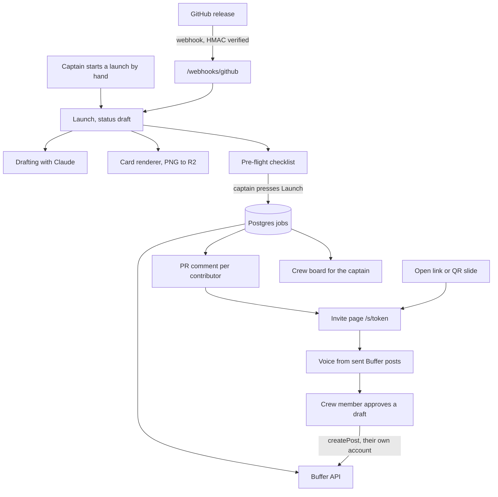

# Launch Crew

Launch Crew turns one announcement into many people's posts, each approved by that person inside their own Buffer account. A captain tags a GitHub release, or starts a launch by hand for a meetup. Contributors join as crew through a consent-first pull request comment, an open link or a QR slide. Each crew member sees a draft written in their own voice and adds it to their own Buffer queue with one tap. Nothing posts without that tap. It is an entry for Buffer Commit 2026.

## Built on the Buffer API

Everything goes through the one GraphQL endpoint, `https://api.buffer.com`, with OAuth (PKCE) per person. Each crew member connects their own account, so every queue is filled by its owner.

| Operation | Why |
|---|---|
| `account` | Identify the connected Buffer account and its organisation. |
| `channels` | List the person's channels so each draft goes to a network they actually have. Cached per organisation for an hour. |
| `configuration` | Read plan limits (channel count, queue size) for the pre-flight checklist. Cached for an hour. |
| `dailyPostingLimits` | Avoid creating posts a channel cannot accept today. |
| `posts` | Read the person's recent sent posts to derive their voice (capped at 100, cached 30 days), and check queued posts. |
| `createPost` | Create the post in one of three modes: `addToQueue`, `customScheduled` inside the launch window, or saved as a draft. |

The pre-flight checklist runs before anything is created in Buffer. Calls stay within a small budget per connect, respect rate limits and `Retry-After`, and never retry `createPost` blindly because it is not idempotent. Code is in `internal/buffer`.

## How it works



### From a release to posts

1. Publishing a GitHub Release is only the trigger. The signed webhook (`release`, action `published`) creates a draft launch from the release notes and the pull requests since the previous tag. Nothing is sent to anyone yet.
2. The captain (the release author) reviews the draft, sets the launch moment or window, and presses Launch.
3. The bot then comments on each contributor's pull request with an invite link. The captain is skipped: their own pull requests get no comment.
4. A contributor opens the link, verifies with GitHub, connects their own Buffer account, edits their post, and approves it into their own Buffer queue. Nothing is posted without that approval.

A single Go binary serves the API, the webhook, the job worker and the embedded React app. State lives in Postgres, which also holds the job queue (claimed with `FOR UPDATE SKIP LOCKED`, five attempts, then dead-letter). Cards are rendered in Go and served from Cloudflare R2.

## Run locally

You need Go (version in `go.mod`), Node, and Docker for Postgres.

```sh
make db-up                      # Postgres 16 in Docker, matches the default DATABASE_URL
cp .env.example .env            # fill in the values; see `.env.example` for each variable
make web                        # builds the React app into internal/httpserver/dist
set -a; . ./.env; set +a        # the server reads the environment, not the file
go run ./cmd/launchcrew
```

For front-end work, run the Go server above and `npm run dev` in `web/`. Vite proxies `/api`, `/auth` and `/github` to port 8080.

Tests:

```sh
make test                       # go test ./... and the web suite
go test -p 1 ./...              # Go only, one package at a time
cd web && npm test              # Vitest
cd web && npm run lint          # stylelint
```

The Playwright suite in `e2e/` starts the server with `LAUNCHCREW_E2E=1`, which swaps Buffer, GitHub, Anthropic and R2 for in-process fakes, so it needs no accounts:

```sh
cd e2e && npm ci && npx playwright install chromium webkit
npx playwright test --project chromium --project webkit
SCREENSHOTS=1 npx playwright test --project chromium    # regenerates the screenshots
```

## Privacy

- Nothing is posted without the crew member's own tap, and the app only adds to their queue.
- The pull request bot is opt-in per repository, comments once per person per release, and never on a PR of someone who opted out.
- Anyone can opt out globally (keyed on their immutable GitHub user id) and delete their stored data from `/settings`, which every comment and crew page links to.
- Buffer tokens and invite tokens are encrypted at rest with AES-GCM and a rotating keyring. Link tokens are looked up by hash.
- No analytics. The app reads only a person's own sent posts, and only to derive a voice.
